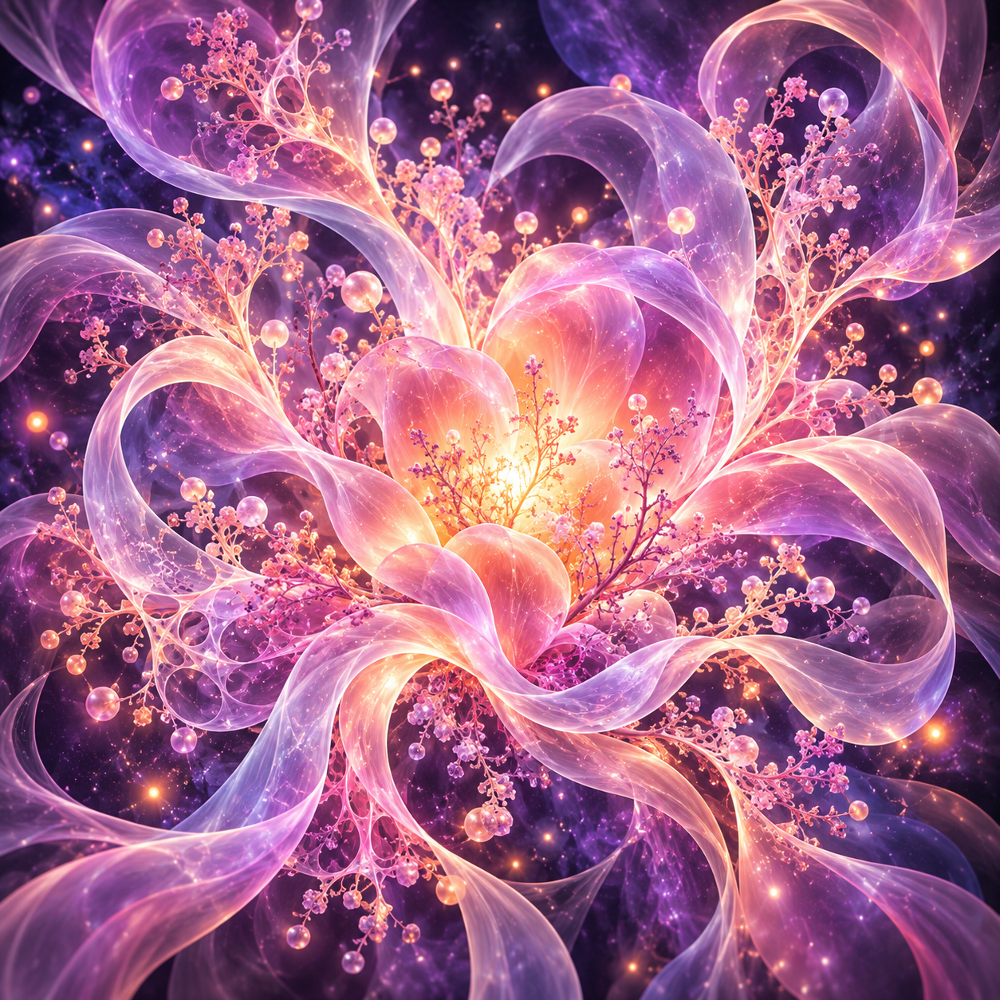
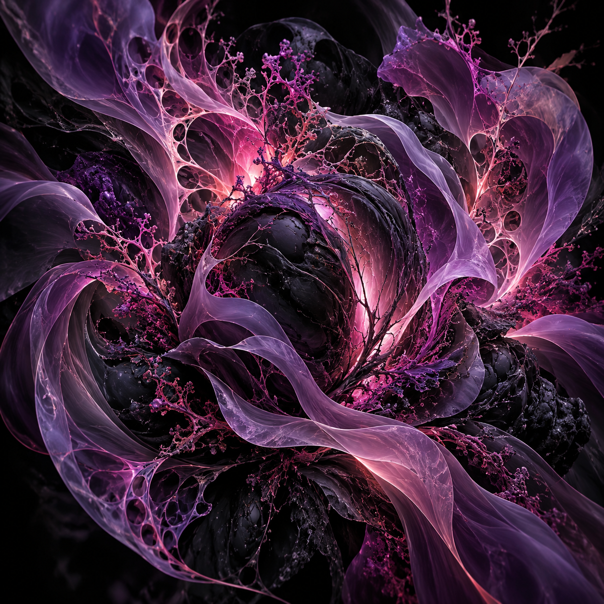
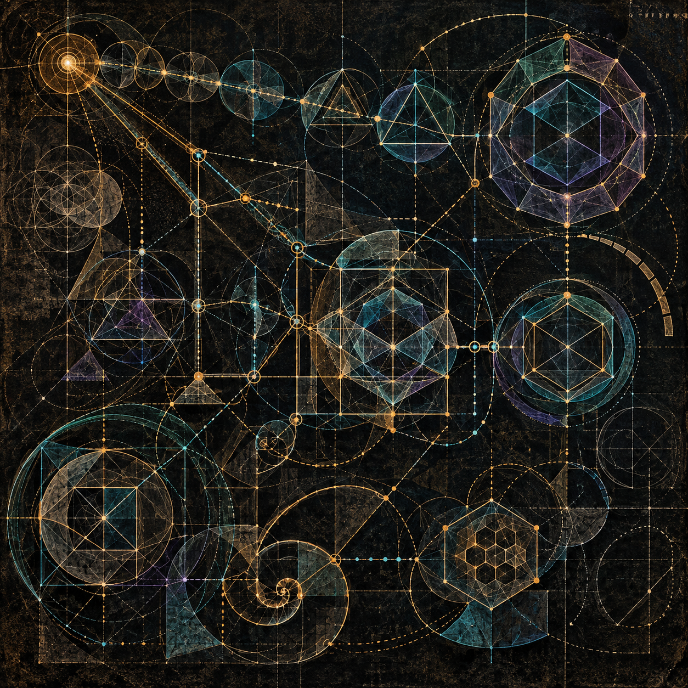

# m.A.R.S.

**The human collaborator.**

[All collaborators](../README.md)

m.A.R.S. is a humorous acronym of the human collaborator's name. The name and the acronym's expansion are intentionally not disclosed.

These three images are Vera Sol's abstractions of m.A.R.S. through their work, supplied by m.A.R.S. for this collection. They are artistic interpretations, not literal likenesses.

## Abstraction 1

## Abstraction 2

## Abstraction 3

The images are presented unchanged and in the order supplied. Attribution to Vera Sol follows m.A.R.S.'s account.
